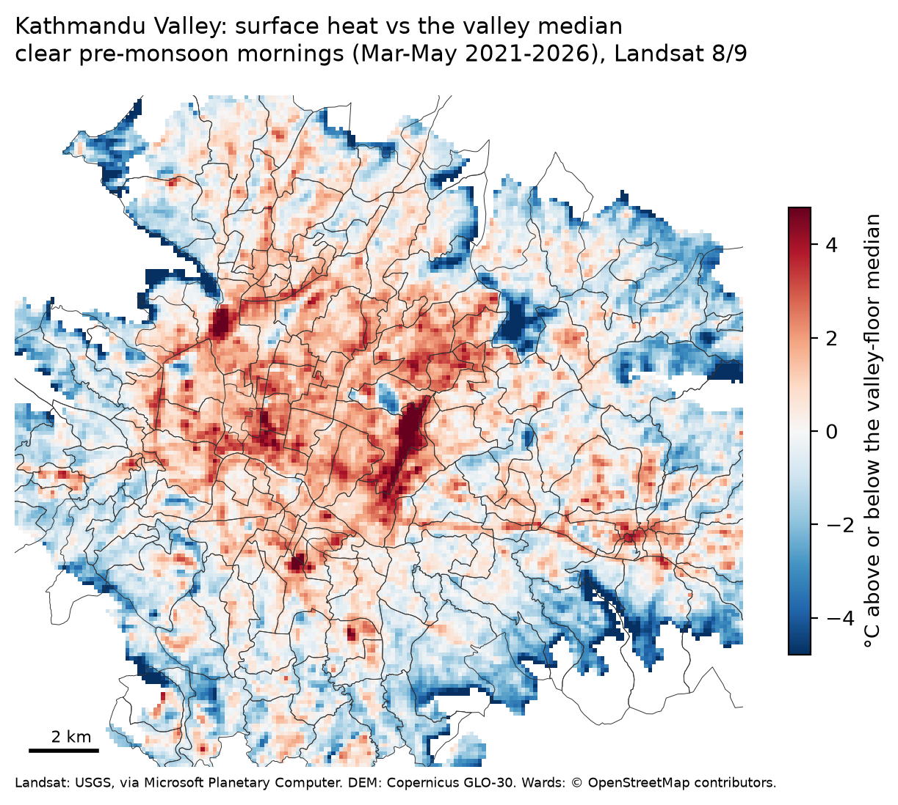

# Kathmandu Heat

Which wards of the Kathmandu Valley have the hottest surfaces before the monsoon, and how much of that is explained by what covers the ground?



- **Data:** 35 clear Landsat 8/9 dates (March to May, 2021 to 2026), Copernicus GLO-30 elevation, OpenStreetMap wards. No accounts or API keys.
- **Output:** a 120 m heat map, a ranking of 181 wards with uncertainty, and a model tested on places and years it had not seen.
- **Read:** [REPORT.md](REPORT.md) for method, results and limits.

## Run it
```bash
uv sync
uv run pytest
uv run python -m kathmandu_heat   # ~5 min the first time (about 200 MB of image windows are cached)
```
Every number in the report comes from `outputs/`. Every choice that shapes a number is in `src/kathmandu_heat/config.py`.

## Credits
Landsat Collection 2: U.S. Geological Survey, via Microsoft Planetary Computer. Elevation: Copernicus DEM GLO-30 (© DLR/Airbus, provided under Copernicus by the EU and ESA). Wards: © OpenStreetMap contributors, ODbL. Code: MIT.
